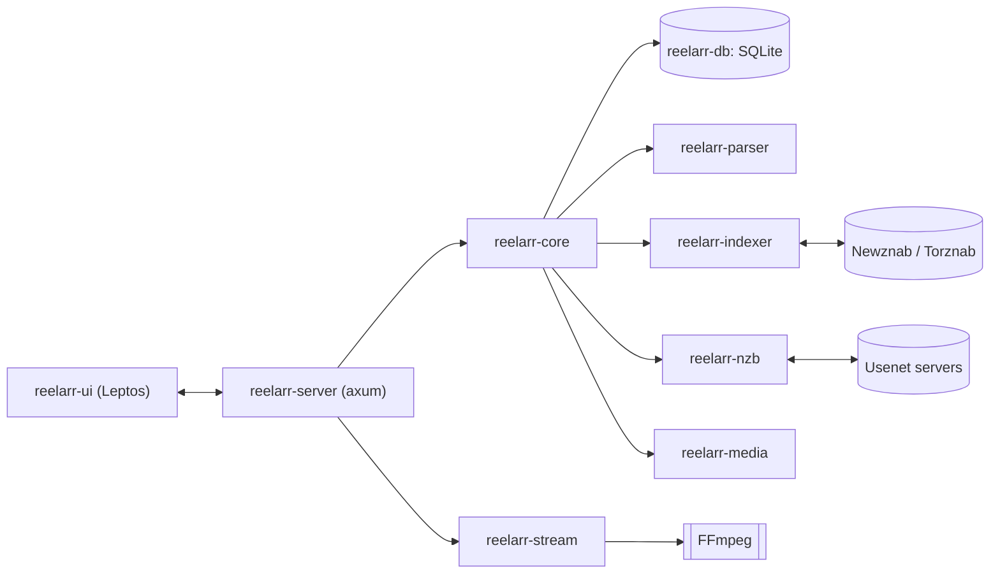

# Reelarr

**One app for your whole media setup.** Reelarr finds, downloads, organizes and plays your movies and TV, all in a single Rust app with a single UI, shipped as a single Docker container.

> **Status: pre-alpha.** Nothing works end to end yet. Follow along in the [milestones](https://github.com/joshrath/Reelarr/milestones).

## Why

A typical self-hosted media stack is six or more apps: an indexer manager, a movie manager, a TV manager, a request app, a download client and a media server, each with its own UI, config and database. Reelarr is all of that in one place.

## Goals

- **Search and requests**: find a movie or show and request it.
- **Indexers**: built-in Newznab/Torznab indexer management.
- **Downloads**: a built-in NZB client (NNTP, yEnc, repair, extract). No separate downloader needed.
- **Library**: import, rename and organize, including manual imports from network shares.
- **Playback**: a built-in media server with direct play and FFmpeg transcoding.
- **One container**: `docker compose up` and you're done.

## Architecture



| Crate | Purpose |
| --- | --- |
| `reelarr-server` | The binary: HTTP API, UI hosting, background jobs |
| `reelarr-ui` | Web UI in Leptos (Rust compiled to WebAssembly) |
| `reelarr-types` | Types shared between server and UI |
| `reelarr-core` | Domain logic: movies, series, quality profiles, decisions |
| `reelarr-db` | Persistence (sqlx + SQLite) |
| `reelarr-parser` | Release-name parsing and quality detection |
| `reelarr-indexer` | Indexer clients and search |
| `reelarr-nzb` | Built-in NZB download client |
| `reelarr-media` | Library scanning, import, rename, metadata |
| `reelarr-stream` | Direct play and transcoding |

## Running (dev)

The web UI is built with [cargo-leptos](https://github.com/leptos-rs/cargo-leptos), which compiles the server and the WebAssembly front end together:

```sh
cargo install cargo-leptos --version 0.3.11 --locked   # once
cargo leptos watch      # dev server with live reload on http://localhost:7979
cargo leptos build --release
```

`cargo run --bin reelarr` still works for the API (`curl http://localhost:7979/health`); pages render without client-side hydration until `cargo leptos build` has produced `target/site`.

Or with Docker:

```sh
docker compose up --build
```

## Roadmap

0. Foundations
1. MVP: movie search, built-in NZB download, import, direct play in the browser
2. Download hardening
3. Parser and quality depth
4. Transcoding
5. TV
6. Indexer manager
7. Requests and users
8. Client apps

Details live in the [milestones](https://github.com/joshrath/Reelarr/milestones) and [issues](https://github.com/joshrath/Reelarr/issues).

## Clean-room policy

Reelarr is inspired by Radarr, Sonarr, Prowlarr, Jellyfin, SABnzbd and Seerr, but contains none of their code. See [CONTRIBUTING.md](CONTRIBUTING.md).

## License

[GPL-3.0-or-later](LICENSE)
